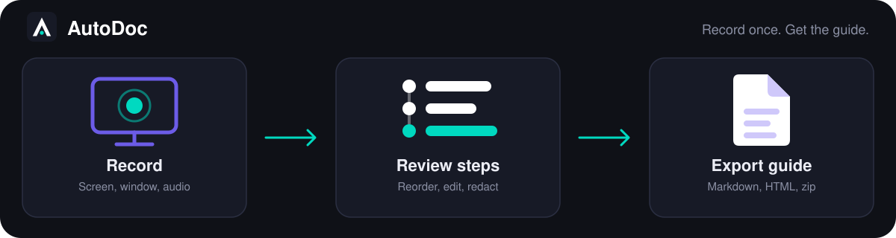

<p align="center">
  
</p>

<h1 align="center">AutoDoc</h1>

<p align="center"><strong>Record a workflow once. Get a captioned, shareable step-by-step guide.</strong></p>

<p align="center">
  A free, open-source desktop app for Windows, macOS and Linux that records your screen, turns every click into a step,
  and exports the result as Markdown, a printable page or an interactive video guide.
</p>

<p align="center">
  
  
  
</p>

<p align="center">
  
</p>

> **Status: early development.** The recorder and editor work today. The guide features (steps from clicks, captions,
> redaction, exports) are being built phase by phase — see [What works today](#what-works-today) and the
> [roadmap](ROADMAP.md) for exactly where things stand. There are no prebuilt downloads yet; you can
> [build it from source](#build-from-source).

## Why AutoDoc

Writing how-to guides, SOPs and client hand-over documents by hand means taking a screenshot, cropping it, writing
a caption and repeating that dozens of times. AutoDoc does it while you work: you perform the task once, and it
produces the guide.

- **Record once** — perform the workflow normally; no pausing to take screenshots.
- **Every click becomes a step** — with a screenshot, the window you were in and what you typed.
- **Fix it before you share it** — delete, reorder and re-word steps, and blur anything sensitive.
- **Ship it anywhere** — Markdown, a printable page, an interactive wizard that jumps the video to each step, or a
  single zip for a client.

## What works today

The recording and editing engine is in place and builds and runs on Windows:

- Record a window or the whole screen, with microphone and system audio.
- Webcam overlay, automatic or manual zoom, a clean editable cursor and click effects.
- A timeline editor with on-device captions (nothing is uploaded) and an editable transcript.
- Video export, and a [command-line interface](docs/cli.md) for headless recording and export.

## What is coming

The guide features come from the original Python version of AutoDoc and are tracked one by one in
[`autodoc-project/FEATURE_INVENTORY.md`](autodoc-project/FEATURE_INVENTORY.md):

| Feature | Status |
|---|---|
| One step per click: screenshot, window title, typed keys | Planned |
| Step review: delete, reorder, edit captions | Planned |
| Automatic captions (window title first, OCR as fallback) | Planned |
| Optional auto-redaction of emails, IP addresses and passwords | Planned |
| Hindi and Gujarati translation of captions | Planned |
| Export to Markdown, printable page and interactive wizard | Planned |
| One-click zip for delivery | Planned |
| Library, Docs and Settings pages | Planned |

## Build from source

Tested on Windows 11. macOS and Linux follow the same steps with their own native tools — see
[`technical-documentation/engineering/build-and-packaging.md`](technical-documentation/engineering/build-and-packaging.md).

**Requirements (Windows)**

| Tool | Notes |
|---|---|
| Node.js | 22.22.1 is pinned in `package.json`; 24 also works |
| Visual Studio Build Tools | "Desktop development with C++" workload and a Windows SDK |
| Rust | via [rustup](https://rustup.rs), MSVC toolchain |
| CMake | 3.x or newer (Ninja is bundled with Visual Studio) |
| LLVM | `winget install LLVM.LLVM` — must end up in `C:\Program Files\LLVM\bin` |

FFmpeg and the ONNX runtime are downloaded for you by the scripts below; you do not need to install them yourself.

```powershell
npm ci
npm run build:native:win           # screen-capture helper (CMake + MSVC)
npm run fetch:ffmpeg               # pinned FFmpeg libraries
npm run fetch:onnxruntime          # ONNX runtime
npm run stage:vcomp                # Visual C++ runtime files
npm run build:native:compositor    # Rust video engine (the first build takes a few minutes)
npm run dev                        # start the app
```

> `build:native:win` ends by running a set of hardware self-tests. On some PCs one video-encoder timing test fails and the
> command exits with an error; the capture helper has already been built and copied by then, so you can carry on.

Other useful commands:

```bash
npx tsc --noEmit    # typecheck
npm run lint        # Biome lint + format check
npm run test        # unit tests
npm run build:win   # full Windows installer
```

## Project layout

| Path | What lives there |
|---|---|
| `src/` | The React app: editor, timeline, captions, translations |
| `electron/` | Main process: windows, recording, IPC, command line |
| `electron/native/` | Native capture helpers (Windows C++, macOS Swift, Linux PipeWire) |
| `crates/` | The Rust video engine that composites and encodes |
| `technical-documentation/` | Architecture and engineering reference |
| `docs/` | Command-line reference and assets |
| `autodoc-project/` | Project plan, phase status, feature inventory and the preserved Python version |

## Documentation

- [Roadmap](ROADMAP.md) and the detailed [phase plan](autodoc-project/PHASES.md)
- [Decisions and project log](autodoc-project/PROJECT_LOG.md)
- [Command-line interface](docs/cli.md)
- [Architecture overview](technical-documentation/architecture/overview.md)
- [Contributing](CONTRIBUTING.md) · [Security policy](SECURITY.md) · [Code of conduct](CODE_OF_CONDUCT.md)

The original Python version of AutoDoc is still available on the
[`main`](https://github.com/The-ViRkumar/AutoDoc/tree/main) branch.

## Built with

Electron, React and TypeScript for the app; Rust for the video engine; FFmpeg for media; ONNX Runtime and Whisper
for on-device features. Full third-party licenses are in [`THIRD-PARTY-NOTICES.md`](THIRD-PARTY-NOTICES.md).

## Contributing

Bug reports and ideas are welcome as [issues](https://github.com/The-ViRkumar/AutoDoc/issues). Before opening a pull
request, read [`CONTRIBUTING.md`](CONTRIBUTING.md) and run the typecheck, lint and tests listed above.

## License

[MIT](LICENSE) — free for personal and commercial use.

Made by [The.ViRkumar](https://github.com/The-ViRkumar).
